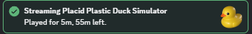
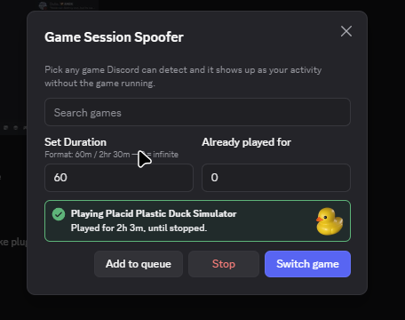

# GameSessionSpoofer
Allows users to spoof Discord gameplay time to achieve the new badges.

# Install
Simply clone the gameSessionSpoofer folder, drop it into your userPlugins folder, rebuild.

# Issues
If you dont get the data added, go to Notrack plugin settings and disable the toggles, and discord data page and share data. (You can revert this once badges are awarded)
Badges can take a day or so to apply.

## Examples

